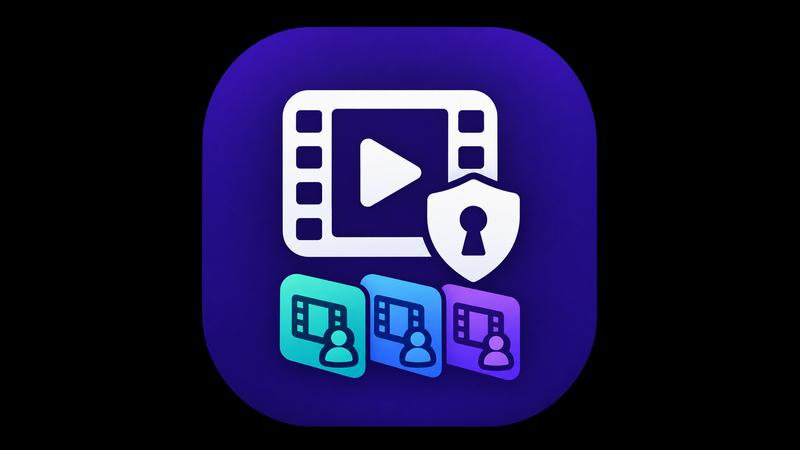

<p align="center">
  
</p>

# Private Libraries (JellyPrivateLibraries)

A Jellyfin server plugin that lets each user narrow their library down to **only the
movies and series they actually want** — the titles they requested through
[Jellyseerr](https://github.com/Fallenbagel/jellyseerr) or picked themselves from a
button in the Jellyfin web UI. Administrators can additionally hide individual titles
from every non-admin user.

It is built on Jellyfin's own per-user **allowed tags / blocked tags** parental-control
filters, so the filtering is enforced by the server for every client (web, mobile, TV
apps), not just in the browser.

## Features

- **Personal library filter (opt-in).** Each user can turn on *“Restrict my library”*.
  While it is on, they only see titles granted to them. Users who never turn it on see
  the full library.
- **Self-service title picker.** A *My Private Library* button in the web UI header
  lets users search the library, add titles to their list, and remove them again.
- **Jellyseerr webhook.** When a request is approved or becomes available, the
  requesting user is granted that title automatically — even if it has not been
  downloaded yet; the grant applies as soon as the media is imported.
- **Jellyseerr history sync.** Optionally reads all existing Jellyseerr requests over
  its API (every 12 hours, or on demand), so requests made before the plugin was
  installed are granted too.
- **Admin-hidden media.** Admins can hide specific movies or series from every
  non-administrator, regardless of anyone's personal setting.
- **Mandatory mode.** Optionally make the filter the default for users who have not
  made a choice.
- **Self-healing.** Grants survive metadata refreshes and follow a title when its file
  is replaced by an upgraded copy; a scheduled task re-applies everything every 30
  minutes and on startup.

> **Important:** this is a *convenience* filter, not an access-control boundary. Every
> user can turn their own restriction off and add any movie or series from the widget
> (including in mandatory mode). Use **hidden media** or Jellyfin's own library access
> settings for content users must not see.

## Requirements

| Requirement | Details |
|---|---|
| Jellyfin server | **12.0.x.** The plugin is built against Jellyfin 12.0.0. Jellyfin 10.11.x is no longer supported — see [Jellyfin 10.11](docs/troubleshooting.md#jellyfin-1011-servers). |
| Web UI button | Either the optional [File Transformation](https://github.com/IAmParadox27/jellyfin-plugin-file-transformation) plugin (recommended), **or** write access for Jellyfin to its web directory. Without either, filtering still works but the button does not appear. |
| Jellyseerr *(optional)* | Needed only for automatic grants from requests. Jellyseerr users must be linked to, or share a username with, a Jellyfin user. |

## Installation

### 1. Add the plugin repository

Copy this repository (manifest) URL:

```text
https://raw.githubusercontent.com/TIGamingTV/JellyPrivateLibraries/main/manifest.json
```

1. In the Jellyfin web UI, open **Dashboard → Plugins**.
2. Open the plugin **Repositories** settings and add a new repository.
3. Enter any name (for example `Private Libraries`) and paste the URL above.
4. Save.

### 2. Install the plugin

1. In **Dashboard → Plugins → Catalog**, find **Private Libraries** (category *General*)
   and install the latest version.
2. **Restart Jellyfin** (Dashboard → Restart, or restart the service/container).
3. **Reload the Jellyfin web page** in your browser (a hard refresh is safest).

### 3. Verify

- **Dashboard → Plugins** lists *Private Libraries* as active.
- **Dashboard → Scheduled Tasks** shows a *Private Libraries* category with
  *Reconcile Private Libraries* and *Sync Jellyseerr requests*.
- A **video-library icon** (tooltip *My Private Library*) appears in the header next to
  the search/user icons on normal (non-dashboard) pages.

If the icon is missing, see [Widget button does not appear](docs/troubleshooting.md#widget-button-does-not-appear).

Manual installation from a release zip is described in
[docs/troubleshooting.md](docs/troubleshooting.md#manual-installation).

## Quick start

**Without Jellyseerr** — nothing needs configuring:

1. Log in as a normal user and click the **My Private Library** icon in the header.
2. Under **Add titles**, search for a movie or series and click **Add**.
3. Switch on **Restrict my library to selected & requested titles**.
4. Close the dialog. The page reloads and the library now shows only the added titles.

**With Jellyseerr** — open **Dashboard → Plugins → Private Libraries** and:

1. Enter a **Webhook shared secret** and click **Save**.
2. In Jellyseerr, add a webhook pointing at `<your Jellyfin URL>/PrivateLibraries/Webhook`
   with the JSON payload shown on the plugin page (including your secret), and enable
   *Request Approved*, *Request Automatically Approved* and *Media Available*.
3. *(Optional)* Enter the **Jellyseerr URL** and **Jellyseerr API key**, then click
   **Save & sync now** to grant existing requests.

Full step-by-step instructions: [Jellyseerr setup](docs/configuration.md#jellyseerr-webhook).

## Configuration at a glance

All settings are on **Dashboard → Plugins → Private Libraries**. Nothing is required
for the widget alone.

| Setting | Default | Purpose |
|---|---|---|
| Personal tag prefix | `jpl` | Prefix of the tags the plugin writes. Set before first use only. |
| Mandatory mode | Off | Restrict users who have not made their own choice. |
| Jellyseerr URL | *(empty)* | Jellyseerr address, as reachable from Jellyfin. Needed for the sync. |
| Webhook shared secret | *(empty)* | Required for the webhook; empty rejects all webhooks. |
| Jellyseerr API key | *(empty)* | Enables the history sync. |
| Run the Jellyseerr sync automatically | On | Run the sync every 12 hours. |
| Also grant requests awaiting approval | Off | Include pending requests in the sync. |

Details, accepted values and side effects: [docs/configuration.md](docs/configuration.md).

## Documentation

- [Configuration reference & Jellyseerr setup](docs/configuration.md)
- [Usage guide](docs/usage.md) — the user widget, hidden media, mandatory mode, scheduled tasks
- [Troubleshooting](docs/troubleshooting.md) — logs, common problems, manual install, updating and uninstalling
- [Development](docs/development.md) — building from source, architecture, releases

## License

MIT — see [LICENSE](LICENSE).
